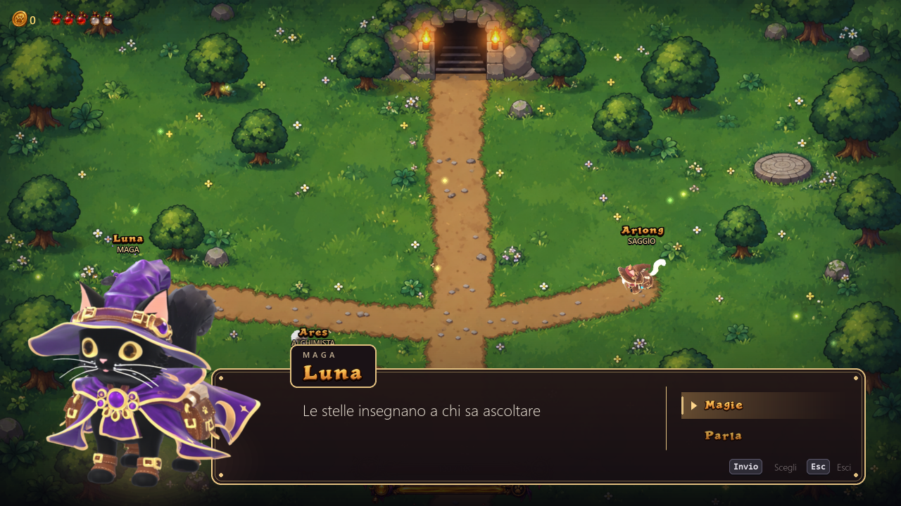
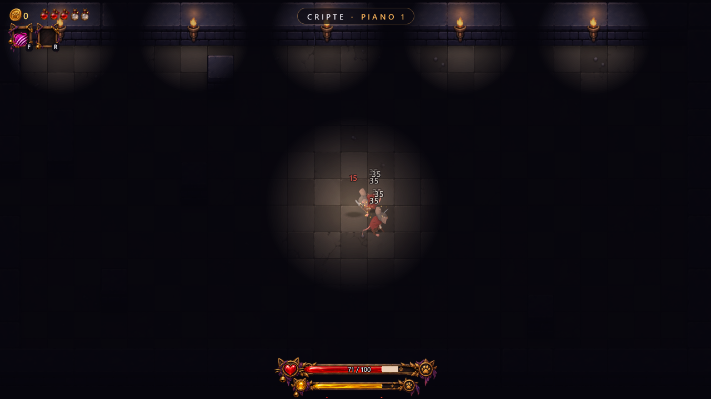
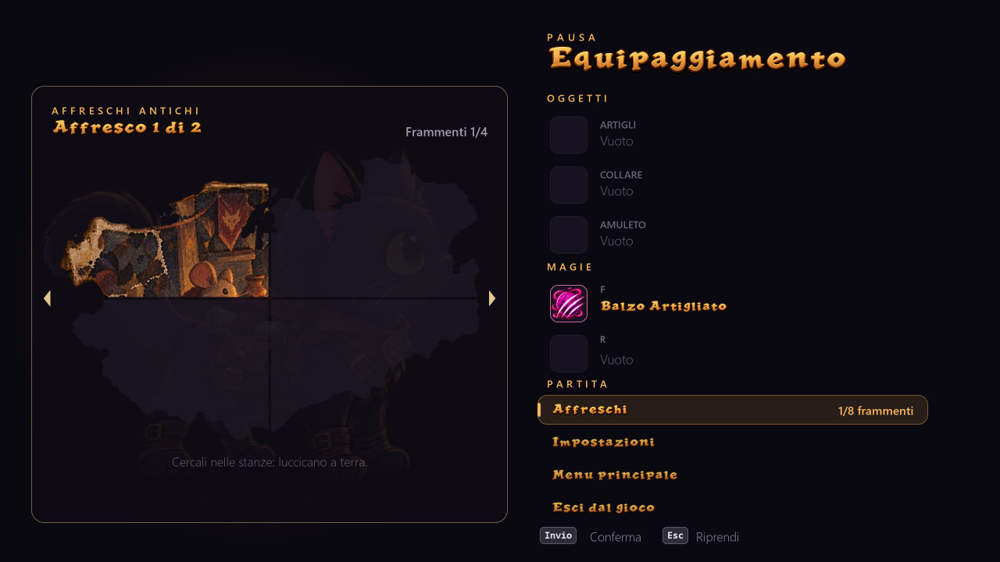

# Kittenbound — Demo

Un roguelike d'azione dove un gattino coraggioso scende nelle cripte dei topi per salvare il principe rapito.
Schiva, para all'ultimo istante e graffia: ogni stanza è una sfida.

*An action roguelike: a brave kitten descends into the rat crypts to rescue the kidnapped prince.
Dodge, parry at the last moment and strike. The demo is in Italian (English coming soon).*

## Scarica la demo

👉 **[Ultima versione (Windows 10/11, 64 bit)](https://github.com/nerdhead3d-sudo/Kittenbound-Demo/releases/latest)**

Scarica `Kittenbound_Setup.exe` dalla pagina della release e aprilo. Non serve installare nient'altro.

**Avviso di Windows:** il gioco è nuovo e non ancora firmato, quindi Windows può mostrare
"Windows ha protetto il PC". Clicca **Ulteriori informazioni → Esegui comunque**.

## Cosa c'è nella demo

- Le Cripte: 3 piani di stanze, nemici e boss
- Schivata e parata perfetta (col contrattacco), magie da comprare e oggetti da trovare
- Stanza di allenamento con il maestro, per imparare con calma
- Il villaggio con Ares l'alchimista, Luna la maga e Arlong il saggio
- Affreschi antichi a pezzi da ritrovare, che raccontano una storia dimenticata
- Tastiera e mouse o controller (PlayStation / Xbox), tasti assegnabili

## Segnalazioni

Hai trovato un bug o hai un'idea? Apri una [segnalazione](https://github.com/nerdhead3d-sudo/Kittenbound-Demo/issues).

© 2026 nerdhead3d. Tutti i diritti riservati.
