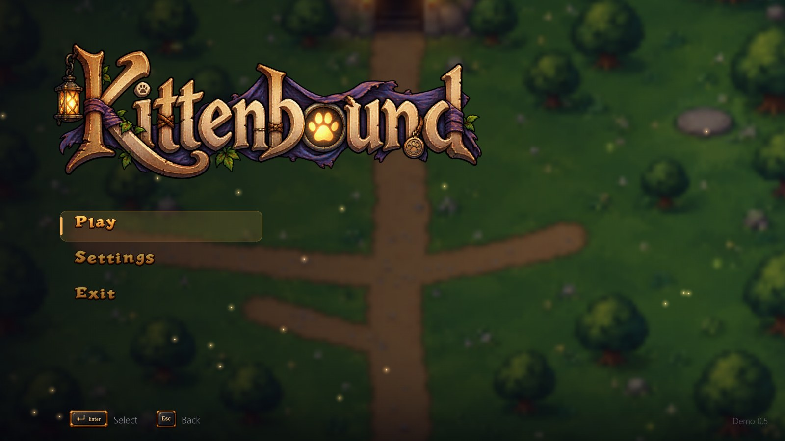
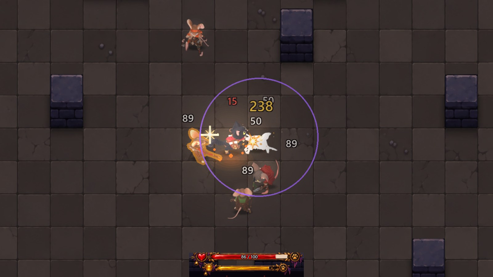
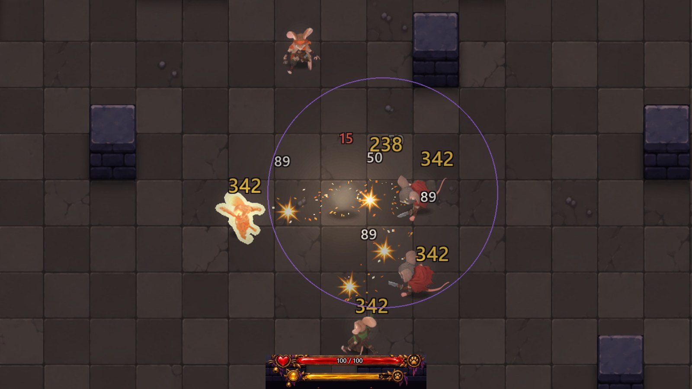
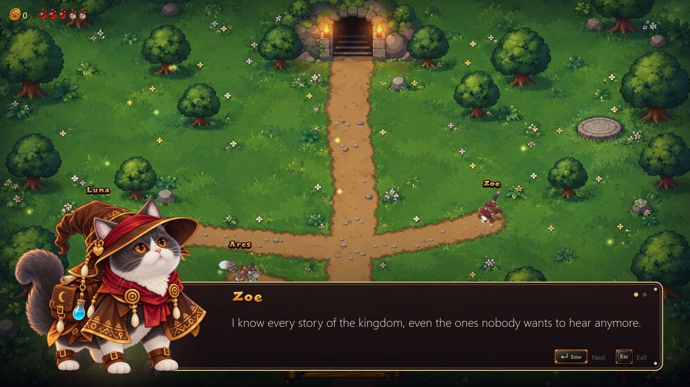
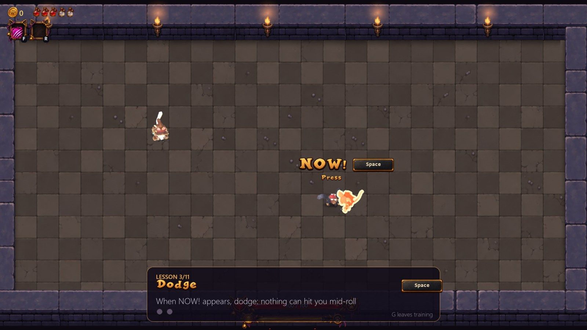
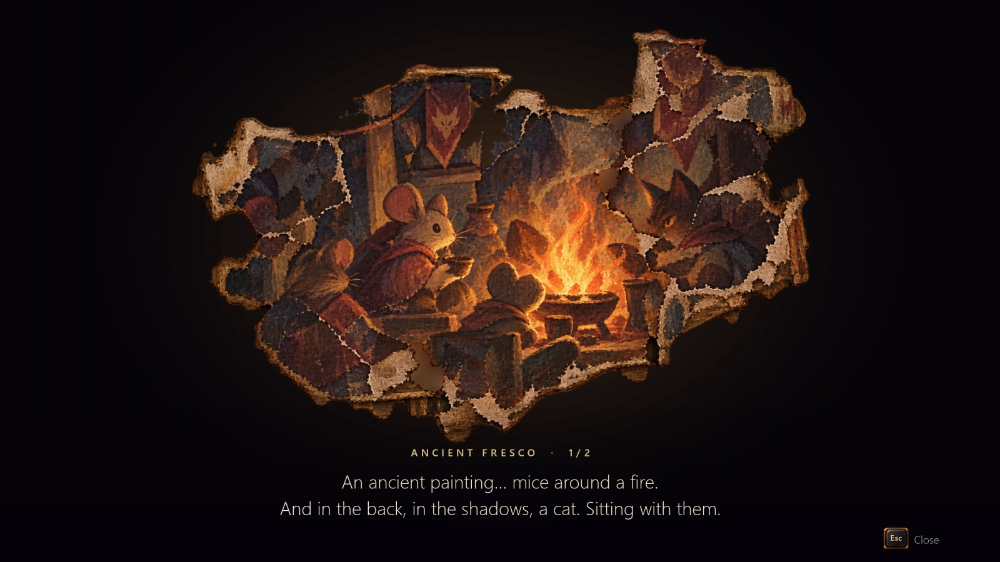
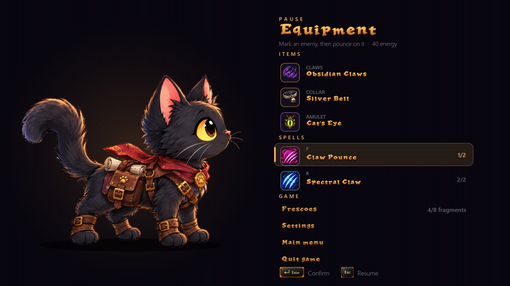

  

<h3 align="center">A hand-painted action roguelike about a small black cat with a big heart.</h3>

  Dodge at the last moment, parry like a master, and burn your courage in a blaze of fire. 
  Go down into the mouse crypts and bring the kidnapped prince home.

  <a href="https://github.com/nerdhead3d-sudo/Kittenbound-Demo/releases/latest"><b>⬇️ Download the free demo (Windows 10/11)</b></a>
  &nbsp;·&nbsp; English &amp; Italiano &nbsp;·&nbsp; Keyboard &amp; controller

---

<table>
  <tr>
    <td width="50%"> <b>Fast, punishing combat.</b> Every hit counts: dodge, parry, strike back.</td>
    <td width="50%"> <b>Daring.</b> Play bravely to grow your flame, then burn it in a devastating blast.</td>
  </tr>
  <tr>
    <td> <b>A village to come back to.</b> Buy spells from Luna and upgrades from Ares.</td>
    <td> <b>A story to uncover.</b> Zoe remembers what everyone else has forgotten.</td>
  </tr>
  <tr>
    <td> <b>Learn at your own pace.</b> The training room slows time down until you get it right.</td>
    <td> <b>Ancient frescoes.</b> Find the scattered pieces and put the truth back together.</td>
  </tr>
  <tr>
    <td colspan="2" align="center"> <b>Gear up.</b> Claws, collars and amulets in five rarities, and spells to mix and match.</td>
  </tr>
</table>

## How to play the demo

1. Download **`Kittenbound_Demo_<version>.zip`** from the [latest release](https://github.com/nerdhead3d-sudo/Kittenbound-Demo/releases/latest).
2. Right-click the zip → **Extract All**.
3. Open the `Kittenbound` folder and start **Kittenbound.exe**. Nothing else to install.

> **Windows warning:** the game is new and not signed yet, so Windows may say *"Windows protected your PC"*.
> Click **More info → Run anyway**.

## What's in the demo

- **The Crypts:** 3 floors of rooms, enemies and bosses
- **Combat:** dodge, perfect parry with counterattacks, spells and gear
- **Daring:** a flame that grows with bold play — burn it for a fiery blast and a few seconds of invulnerability
- **Training room** with a master, to learn every move
- **The village:** Ares the alchemist, Luna the mage and Zoe the sage
- **Ancient frescoes** broken into pieces, telling a forgotten story
- **Keyboard & mouse or controller** (PlayStation / Xbox), fully rebindable

## Feedback

Found a bug or have an idea? [Open an issue](https://github.com/nerdhead3d-sudo/Kittenbound-Demo/issues) — every report helps.

---

### 🇮🇹 Italiano

Un roguelike d'azione dipinto a mano: un piccolo gatto nero scende nelle cripte dei topi per salvare il principe rapito.
Il gioco è in **italiano e inglese**.

**Come si gioca:** scarica lo zip dall'[ultima versione](https://github.com/nerdhead3d-sudo/Kittenbound-Demo/releases/latest),
tasto destro → **Estrai tutto**, poi avvia **Kittenbound.exe** nella cartella `Kittenbound`.
Se Windows mostra *"Windows ha protetto il PC"*, clicca **Ulteriori informazioni → Esegui comunque**.

© 2026 nerdhead3d. All rights reserved / Tutti i diritti riservati.
