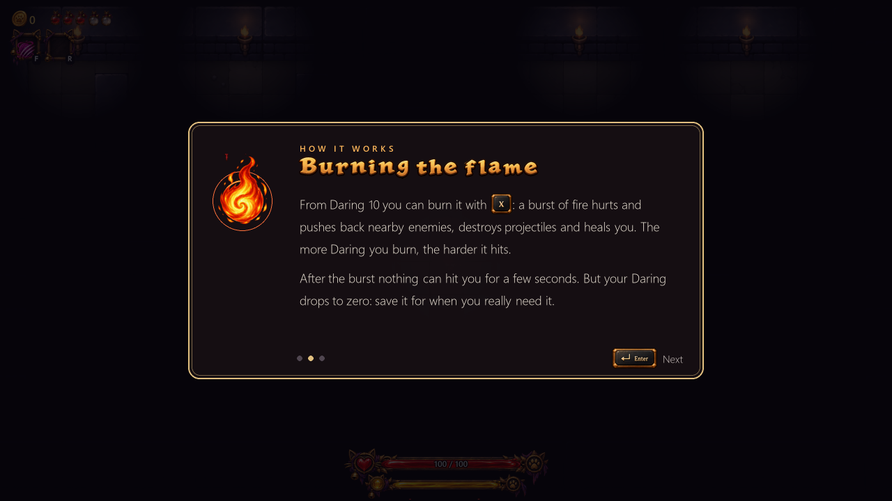

# Kittenbound — Demo

**English** · [Italiano](#italiano)

An action roguelike: a brave little black cat goes down into the mouse crypts to rescue the kidnapped prince.
Dodge, parry at the last moment and strike back. Every room is a fight.
The game is fully playable in **English and Italian** (choose it on first launch or in Settings).

## Download

👉 **[Latest version (Windows 10/11, 64-bit)](https://github.com/nerdhead3d-sudo/Kittenbound-Demo/releases/latest)**

1. Download `Kittenbound_Demo_<version>.zip` from the release page.
2. Right-click it → **Extract All**.
3. Open the `Kittenbound` folder and start **Kittenbound.exe**. Nothing else to install.

**Windows warning:** the game is new and not yet signed, so Windows may show
"Windows protected your PC". Click **More info → Run anyway**.

## What's in the demo

- The Crypts: 3 floors of rooms, enemies and bosses
- Dodge and perfect parry (with counterattack), spells to buy and items to find
- Daring: a flame that grows as you play bravely — burn it for a huge fiery blast
- Training room with a master, to learn at your own pace
- The village with Ares the alchemist, Luna the mage and Arlong the sage
- Ancient frescoes broken into pieces, telling a forgotten story
- Keyboard and mouse or controller (PlayStation / Xbox), fully rebindable keys

## Feedback

Found a bug or have an idea? [Open an issue](https://github.com/nerdhead3d-sudo/Kittenbound-Demo/issues).

---

## Italiano

Un roguelike d'azione: un gattino nero coraggioso scende nelle cripte dei topi per salvare il principe rapito.
Schiva, para all'ultimo istante e contrattacca. Il gioco è in **italiano e inglese**.

### Scarica la demo

👉 **[Ultima versione (Windows 10/11, 64 bit)](https://github.com/nerdhead3d-sudo/Kittenbound-Demo/releases/latest)**

1. Scarica `Kittenbound_Demo_<versione>.zip` dalla pagina della release.
2. Tasto destro → **Estrai tutto**.
3. Apri la cartella `Kittenbound` e avvia **Kittenbound.exe**. Non serve installare niente.

**Avviso di Windows:** il gioco è nuovo e non ancora firmato, quindi Windows può mostrare
"Windows ha protetto il PC". Clicca **Ulteriori informazioni → Esegui comunque**.

© 2026 nerdhead3d. All rights reserved / Tutti i diritti riservati.
